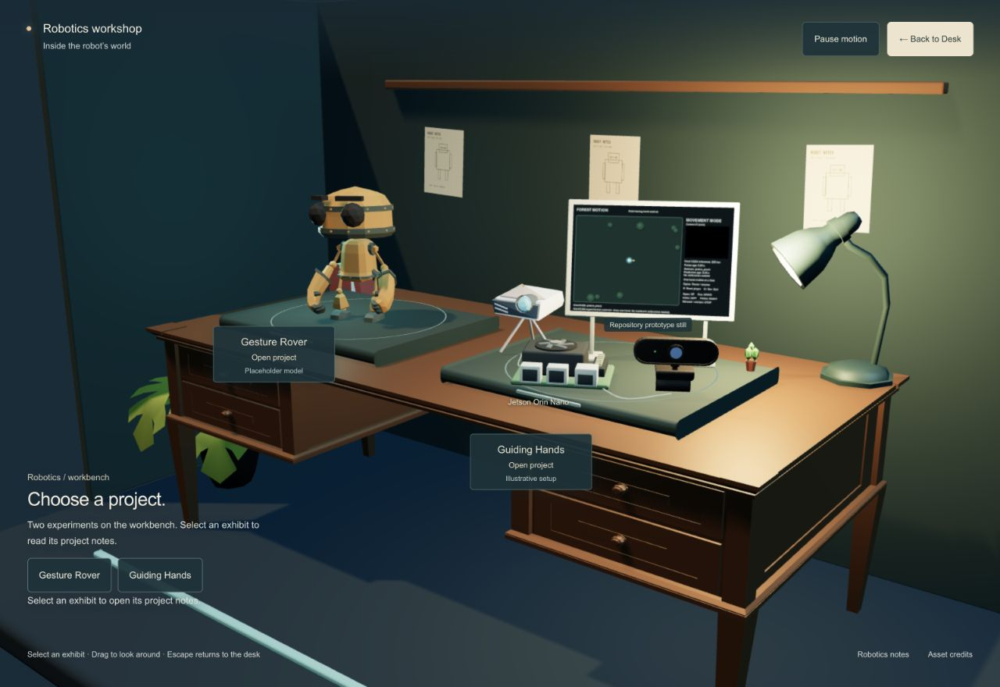

# Guiding Hands refinement — D-025 · 2026-11-03

Ready for visual review. Only Guiding Hands presentation was refined: the projector lens faces the default camera, webcam and Jetson are separated at the front, and an upright projection board shows an authentic repository prototype still. A short-range local fill reveals the equipment without changing the room lighting. One small plant remains; paper-stack geometry is no longer displayed. The Guiding nameplate sits below the hardware at both viewport sizes.

## Authentic image and honest representation

The board uses the unchanged [FOREST MOTION experimental-control screenshot](https://github.com/BigZ509/guiding-hands/blob/main/benchmark-results/smol-live-smoke.png), Git blob `db6b70a793833c3a1acf28e76a7e618d5c302585`, 1120×760, 56,832 bytes. Its native aspect ratio is preserved. The board caption says “Repository prototype still”; the project panel identifies it as archived. Diagnostic metrics visible inside the screenshot are archived text, not new performance measurements. The forest map artwork was inspected but not substituted for gameplay. [Local provenance](../public/images/guiding-hands/provenance.json) records source, hashes and user authorization.

The hardware remains illustrative. Jetson geometry is original and stylized, not an official NVIDIA asset or exact replica. Equipment is arranged for viewing, not optical alignment or accurate electrical wiring. Both demo videos remain unavailable. Confirmed project text and GitHub link are preserved; no live feed, camera access, invented demo or functionality claim was added. Existing [hardware credits](../public/licenses/guiding-hardware/ATTRIBUTION.md) remain in place.

## Changes and preservation

- `GuidingHandsSetup.tsx`: equipment orientation/spacing, board/stand, static sRGB texture and local fill. Texture ownership disposes only the cloned sampler, preserving the cached source.
- `Workshop.tsx`: only Guiding label placement changes; Rover placement and interaction handlers remain intact.
- `hub.module.css`, `exhibits.ts`: small pointer-transparent caption and archived-image representation note.
- New repository PNG/provenance; credits, review and project memory updated.

All 16 GLB files match the prior hashes. DeskScene matches D-022; shared panel/HubExperience match D-024. Journey, robot, camera presets and asset adapter are byte-identical to HEAD. No dependency, broader room, camera, other-world, Git publication or deployment change. An independent source review found no actionable issue.

## Verification

Final static build `hsoZYZ1tyte_JMdQWewVf`: `npm run build`, `npm run typecheck`, `npm test` (8/8) and `git diff --check` pass. [Hash/source verification](../output/playwright/guiding-refinement/verification.json) and [native browser results](../output/playwright/guiding-refinement/native-browser-evidence.json) retain evidence.

Native Chrome on macOS visibly rendered the final build at 1280×880 and 390×844 CSS pixels. Exact actions/results:

| Path | Result |
| --- | --- |
| Actual projector, Jetson, webcam and board clicks, desktop and portrait | Pass: each opens Guiding Hands |
| Rover mesh selection and panel project switching | Pass |
| Escape close/focus restoration; Space reopen | Pass |
| Inspection preserves workshop camera | Pass |
| Manual Pause, immediate return/re-entry | Pass |
| Portrait orbit drag from hardware rejects selection | Pass |
| Escape return restores original desk pose and entry focus | Pass |
| Real touch, initial OS reduced-motion preference, other browsers | Not tested this pass |

Desk pose restored exactly: position `[9.300000000000002,7.15,11.4]`, target `[0,2.9,-0.1]`. Workshop default pose remains `[6.6,5.5,8.1]`, target `[0,2.65,-0.3]`. [Panel capture](../output/playwright/guiding-refinement/03-project-panel.jpg), [portrait scene](../output/playwright/guiding-refinement/04-portrait-workshop.jpg), [portrait panel](../output/playwright/guiding-refinement/05-portrait-panel.jpg). The partial `02-hardware-detail.jpg` crop is retained but excluded from visual acceptance; use the full scene.

No application errors appeared in captured native browser logs; two existing Three.Clock deprecation warnings remain. DOM-only inspection does not expose browser version/GPU or canvas `getContext`/`navigator`; failed inspection attempts were tooling limitations, not application failures. Visible WebGL was verified, but renderer type is unknown. Portrait testing used real pointer clicks in a resized browser, not touch/device emulation. Manual Pause tested the immediate journey path; it does not establish initial OS preference coverage. No physical-device, hardware-performance, accessibility-conformance, screen-reader or video-playback claim. Snapshot counters are not a benchmark.

## Reference comparison and next step

The retained Old Sins dollhouse, Stray Clementine apartment and Max dorm desk images were reopened beside the actual workshop capture. [Recorded comparison](../research/hub-world/VISUAL_REFERENCES.md): explicit object inspection remains discoverable; amber wood/cool background remain; authentic project imagery provides personal context without more room clutter. Materials and environmental density remain simpler than those games. No proprietary reference asset enters production.

Review the default and portrait views. Actual hardware photos and confirmed demo videos remain pending. Stop before other worlds or further feature work. Only this task's QA tab/server were closed; the user's existing preview was left untouched.
