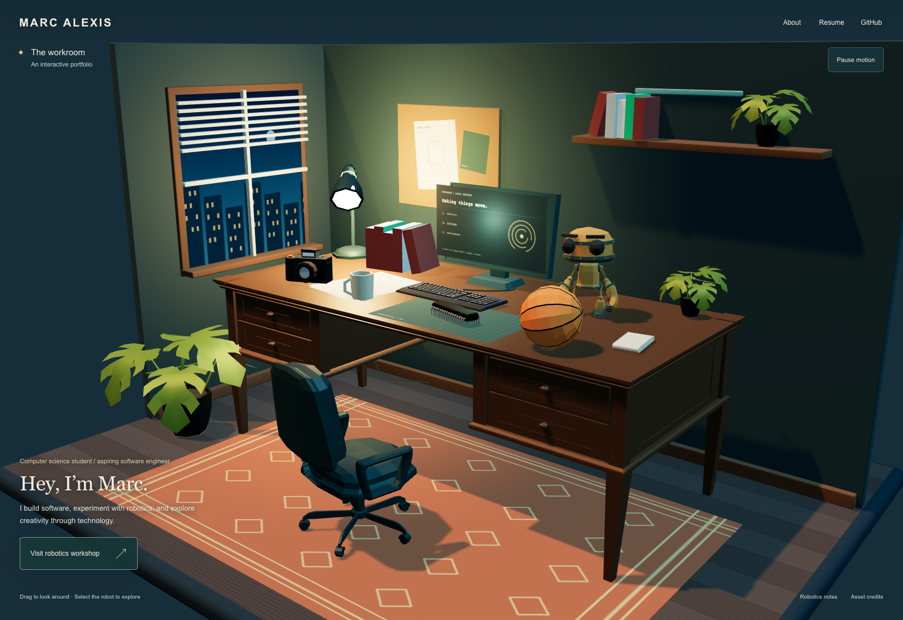

# Marc Alexis identity and header — D-026 · 2026-11-04

Ready for visual review. Objective1 adds a personal identity/navigation layer to the working cinematic room. Scene, objects, robot, lighting, camera and world journey remain intact. No other worlds, new object labels, onboarding, dependencies, Git publication or deployment.

[Before: archived actual desk capture](../output/playwright/portfolio-identity/before-desk-archived.png) · [After: desktop](../output/playwright/portfolio-identity/01-after-desk.png) · [Portrait](../output/playwright/portfolio-identity/mobile-01-desk.png) · [Workshop](../output/playwright/portfolio-identity/05-workshop.png) · [About](../output/playwright/portfolio-identity/02-about.png).

## Design and destinations

Persistent MARC ALEXIS at the upper left, About / Resume / GitHub at the right. Existing ivory/amber and a quiet contrast wash keep it integrated with the room; no large bar, extra icons or font download. The desk's existing lower-left caption carries a modest Georgia greeting, student/aspiring-engineer line and supplied software/robotics/creative copy. The location subtitle explicitly calls this an interactive portfolio. Workshop caption and controls stay available.

About is a small native dialog containing only the user's confirmed biography/interests. Resume opens an honest unavailable explanation: no asset or configured URL was found. There is no guessed resume anchor. GitHub points to [BigZ509](https://github.com/BigZ509), confirmed by the repository remote and user account; the actual browser click opened that profile in a separate tab. No username lookup or account changes.

Native dialogs contain focus, close with Escape and restore the invoking nav focus. Escape is stopped before the workshop shortcut, including when About overlays the project inspector. Only real navigation controls receive pointer events; dragging through empty header space still orbits the room. Identity refs are local to their component, so dialog opening does not update the Canvas owner. Header persists in both worlds and fallback. No decorative motion is added.

The scene utility row sits below personal navigation. Desktop project inspector starts below utilities, with a compact short-height offset. Short-height captions use smaller type; the workshop description/status no longer paint across exhibit labels, while both project buttons remain and the status stays available to assistive technology. Very narrow short screens can scroll the caption. This is an HTML layout adjustment, with no 3D repositioning.

## Files and preservation

- New: `src/features/hub/PortfolioIdentity.tsx`, `identity.module.css`.
- Updated: `HubExperience.tsx` identity insertion, utility wrapper and desk text; `hub.module.css` scoped identity/responsive styles and inspector offset.
- Updated: `src/app/layout.tsx`, `src/app/hub/page.tsx` titles/descriptions.
- Design/plan, evidence and project memory.

All16 GLBs, dependencies and every baseline source file except the four intended HTML/style/metadata files match their starting hashes. Existing D-022–D-025 changes are preserved. Core scene, robot, presets, journey, project data and project inspector implementation are unchanged. [Hash verification](../output/playwright/portfolio-identity/verification.json).

## Verification

`npm test`8/8, typecheck, production/static export and diff check pass. Exact build identity is in [verification.json](../output/playwright/portfolio-identity/verification.json); [build](../output/playwright/portfolio-identity/build.log), [unit](../output/playwright/portfolio-identity/unit.log), [typecheck](../output/playwright/portfolio-identity/typecheck.log) logs retained. Independent source review identified short-landscape caption overlap; compact rules and actual browser measurements/screenshots address it. Visual QA then caught the workshop description crossing a label; the corrected compact caption is captured, with the original overlap image retained.

Actual final-build browser evidence: [desktop actions/results](../output/playwright/portfolio-identity/desktop-cli.log), [touch/responsive/initial reduced motion](../output/playwright/portfolio-identity/responsive-cli.log), [short inspector/dialog](../output/playwright/portfolio-identity/short-panel-cli.log). Reproducible CLI action functions are stored alongside logs.

| Path | Result |
| --- | --- |
| Header/name/introduction visible at1600×1100 and390×844 | Pass |
| About focus containment, Close/Escape and nav focus restoration | Pass |
| Resume unavailable explanation, keyboard activation/focus | Pass |
| Actual GitHub popup to BigZ509 | Pass |
| Empty header passes pointer/orbit to Canvas | Pass |
| Robot mesh hover/Wave progression/click and camera approach/workshop | Pass |
| Workshop header, About Escape, About over project inspector | Pass |
| Both project mesh panels, switching, unavailable videos preserved | Pass |
| Same Canvas, exact orbited camera and invoking focus return | Pass |
| Manual Pause immediate round trip | Pass |
|390×844 touch emulation and initial reduced-motion preference | Pass |
|740×360,800×360,320×568 header/control/caption bounds | Pass |
| Short landscape project body scroll and About Escape preservation | Pass |
| Physical devices, other browsers, screen readers/conformance | Not tested |

Browser is HeadlessChrome156 on macOS; renderer reports `ANGLE (Apple, ANGLE Metal Renderer: Apple M5, Unspecified Version)`. Touch is emulation, not a physical phone. No performance or accessibility-conformance claim. Main browser checks record no page errors or ready-scene request failures; existing Three.Clock deprecation remains. Initial launch also logged existing favicon404.

Initial desktop attempt observed robot-asset `net::ERR_ABORTED` during full-page navigation. The test was corrected to observe request failures after scene ready, matching the acceptance scope; the initial log is retained, no application network fix claimed. First mobile tap targeted an empty gap beside Rover's arm and timed out; corrected to the visible torso, both normal and reduced-motion touch runs pass. Those attempts remain in `desktop-first-attempt.log` and `responsive-first-attempt.log`.

CUA tab navigation/inspection/screenshot calls failed on a missing timeoutMs field. Documented reset/native alternatives were attempted; native control then reported the user changed Chrome, so that path stopped. The user explicitly chose terminal Playwright, which completed the actual tests above. These tool failures are distinct from application errors. Local preview used an approved sandbox escalation. Only the task's isolated Playwright session/server are cleaned up; user's4183 preview is preserved. CUA could not confirm cleanup of its failed blank tab.

## Reference comparison and remaining dependency

Actual captures were compared with the retained Old Sins dollhouse, Stray Clementine apartment and Max dorm desk references. The same wide three-quarter miniature, warm practical/cool ambient lighting and room detail remain. Identity occupies existing negative space instead of changing scene framing. The personal introduction adds context comparable to Max's personal desk storytelling; the environment remains simpler and cleaner than the reference games. The robot's object-to-world invitation and return remain intact. [Recorded comparison](../research/hub-world/VISUAL_REFERENCES.md). No proprietary game asset is reused.

The before image is an unchanged actual D-022 capture at the same1600×1100 framing, not a newly captured before state. It is explicitly archived; after captures show this implementation.

Marc's resume PDF or confirmed URL is still needed to enable a download. The unavailable explanation remains functional. Review desktop/portrait identity and navigation; stop before Objective2 or any other world.
