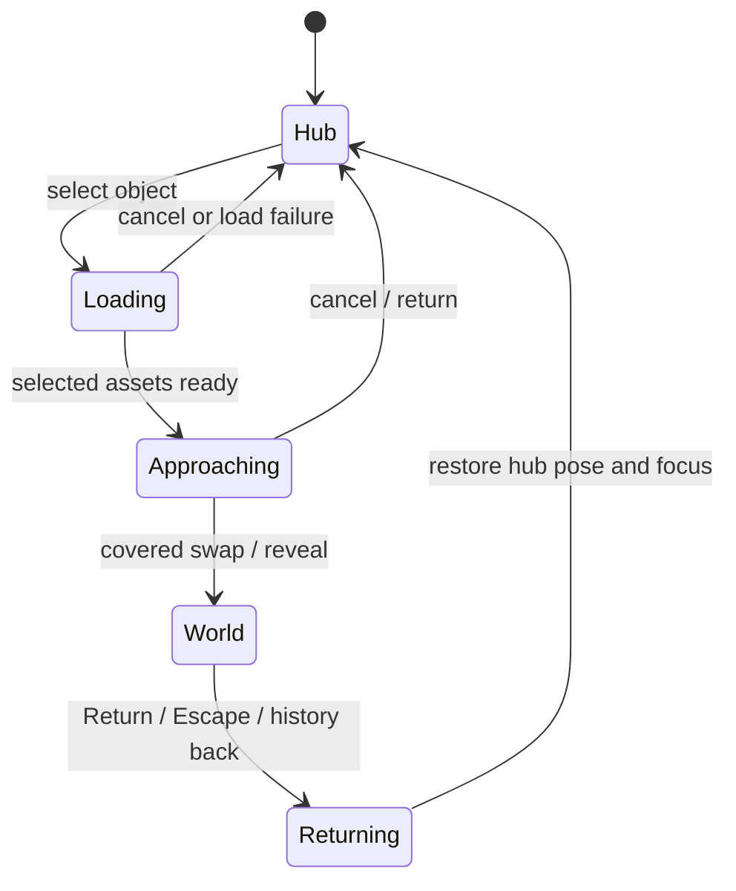

# Recommended hub-world architecture

**Proposal only, 2026-11-01.** Retain approved Next.js + TypeScript/static export + R3F/Drei. Replace the earlier editorial experience model with a desk hub. Existing application code is historical and frozen; the diagram/tree below are planning artifacts.

## Three approaches compared

| Approach | Benefit | Cost / risk | Recommendation |
| --- | --- | --- | --- |
| Camera push → short covered swap → one active world | Existing CameraControls handles travel; destination modules load separately; simpler event/resource ownership | Handoff must be art-directed; not literally a window into a live world | **Default for phases 1–3** |
| Camera push + MeshPortalMaterial blend | Existing library creates a real visible sub-scene and blended entry | Extra render targets/passes, event and lighting ownership, overlapping scene memory | Optional phase 4 experiment, one portal first |
| Keep every world in a large shared physical room | Continuous spatial travel without swapping | Four worlds' assets/events/ambient animation, long travel, framing and mobile cost | Reject as initial architecture; one canvas alone does not make this cheap |

Source basis: [CameraControls](https://drei.docs.pmnd.rs/controls/camera-controls), [portal material](https://drei.docs.pmnd.rs/portals/mesh-portal-material), [R3F scaling](https://r3f.docs.pmnd.rs/advanced/scaling-performance); inspected reusable implementations and rights in [Sources](SOURCES.md). Resource-cost judgments are architectural inferences, not measurements of this future hub.

## Suggested scene graph

```text
Next server-rendered shell
├── Category navigation / direct content links
├── ExperienceClient (lazy canvas boundary + loading/error/static fallback)
│   └── ExperienceCanvas                         ONE renderer / WebGL context
│       ├── CameraRig                           ONE Drei CameraControls owner
│       ├── QualityPolicy / lighting host
│       └── ActiveWorldHost
│           ├── HubScene                        active only in hub/travel
│           │   ├── Selected desk + room dressing
│           │   ├── RobotPortal                 existing RobotExpressive
│           │   ├── BasketballPortal            selected existing ball mesh
│           │   ├── CameraPortal                selected existing camera mesh
│           │   └── SoftwarePortal              chip OR existing keyboard
│           └── MiniWorld                       exactly one active destination
│               ├── RoboticsWorld               selected robot + workshop assets
│               ├── AboutWorld                  selected ball + court behavior
│               ├── PhotographyWorld            camera + licensed photo environment
│               └── SoftwareWorld               development object + project displays
├── ExperienceHUD                               real DOM, outside canvas
│   ├── Named selection controls / current location
│   ├── Return to desk / Skip motion / Pause motion
│   └── Read category / project links
└── Static content routes                       work without canvas or JS
```

Mini-world names are module slots, not four simultaneously mounted children. A selected world may temporarily coexist with hub resources while loading/transitioning; all inactive animation and picking stops. “Hidden” is not equivalent to unloaded GPU resources. Keep a small hub cache for fast return if measured memory permits; use a bounded cache/disposal policy for destinations and never dispose shared loader resources from an arbitrary object component.

## Interaction / travel contract



- **Idle:** bounded, low-amplitude motion using existing clips/helpers; pause/offscreen/reduced-motion policies. Avoid perpetual ball physics on the desk.
- **Hover/focus:** one selected target, clear label plus emissive/material change or existing gesture. Real DOM focus feeds the same state as pointer hover. Clone cached materials before local changes. No global hover state leak when switching worlds.
- **Select:** primary pointer click/tap or Enter/Space on the category's DOM world button sends the same command. Ignore orbit drags; don't require hover or double-tap on touch.
- **Travel:** save hub pose/target and invoking control; load only the requested world with visible progress, cancellation and failure path. CameraControls approaches a calibrated object anchor. Cover the scene swap with a short fade/occlusion, then establish the destination pose. Timing is tunable, not hard-coded to robot clip completion. Keep Back/Skip available while input to other objects is suspended.
- **World:** one active destination, its own art/interaction module and category links. Returning must not require finishing a game or camera animation.
- **Return:** restore hub at the saved approach pose under cover, then move out to the saved hub pose; restore selection/focus. Reduced-motion returns snap rather than travel. Browser back and direct links use the same coordinator.
- **Interruption:** use a transition identity so stale load/motion completions cannot reopen an abandoned world. On context loss, load error, route departure or unmount, stop travel/clip callbacks, clear selection and expose semantic destinations. Retry is explicit. Don't replicate S1's uncancelled timer/removal logic.

The hub-to-world lifecycle is project-specific coordination around reused systems, not an existing four-world application we have found. No new camera engine, raycaster, animation mixer, physics engine or portal shader is proposed.

## Routing and accessible access

Keep the canvas lifetime within one experience page initially. Proposed URL state: `/#world=robotics` (and corresponding category IDs) for enhanced world selection; hash changes/history restore world state without remounting the renderer. On direct load, render the semantic shell first and load only the requested enhanced destination. Malformed/unknown world IDs return to hub. Selection and return push/replace history deliberately so Back restores the previous world/hub rather than trapping the user.

Maintain static `/robotics/`, `/about/`, `/photography/` and `/projects/` routes with real anchors, visible independently of scene readiness. A world button enters the enhanced experience; an adjacent category/read link reaches content immediately. No-JS/WebGL failure removes or disables unavailable enhancement controls while leaving those links usable. Reduced-motion users can select worlds through immediate state changes, with no camera flight or flashing shutter. Static export emits real route HTML; fixed paths avoid runtime-only dynamic routing. Source: [Next static export](https://nextjs.org/docs/app/guides/static-exports).

The previous “navigate immediately, decorative feedback only” proposal still governs direct content links. The optional enhanced travel path is a deliberate new contract under D-012; it is not blocked from using loading/camera transitions, and never removes the immediate content path.

## Proposed modules and source ownership

```text
src/app/                         exported shell + four semantic category routes
src/features/experience/
  ExperienceClient.tsx          client-only lazy boundary; no browser API in server render
  ExperienceCanvas.tsx          single Canvas, error/context-loss boundary
  ExperienceHUD.tsx             focusable controls, status, return and links
  state/                       world lifecycle, history adapter, selection commands
  camera/CameraRig.tsx          adapter to Drei CameraControls; saved poses/cancellation
  hub/HubScene.tsx              selected room assets + object placement
  hub/portalRegistry.ts         IDs, labels, content URLs, hit/approach anchors
  objects/                     robot / basketball / camera / software source adapters
  worlds/                      four independently lazy destination modules
  quality/                     motion preference, pause, render/DPR policy
public/models/                  ONLY selected licensed assets after authorization
public/licenses/                code notices + model/texture/animation provenance
```

This tree is proposed; no modules were created. Registry data supplies labels, selected asset IDs, transforms, approach poses, world entry poses and import functions. Object adapters own clip/material reactions; world modules own destination content/presentation; coordinator owns selection/load/travel/return. Camera has one writer. Begin with React state/context, not a new state-machine dependency. Add neither GSAP nor Motion just to duplicate CameraControls; existing physics dependencies are considered only for the basketball world after its port check.

## Performance and accessibility requirements

- Lazy scene and destination imports. Do not preload all four worlds on arrival; preload on deliberate focus/intent when bandwidth policy allows. Self-host selected models/decoders with retained notices after approval.
- Start testing at DPR 1 on mobile and cap desktop DPR provisionally; low-cost lighting, limited shadows, no default full-scene bloom/SSAO or four live render textures. Record actual transfer, triangle/draw counts, texture memory estimates and peak world-switch memory before setting asset budgets.
- Use demand rendering only at rest; active idles/mixers/travel must request frames. Pause ambient animation when hidden and provide motion pause. Source: [R3F scaling](https://r3f.docs.pmnd.rs/advanced/scaling-performance).
- Validate a provisional sustained **30 fps mobile / 60 fps desktop** target on named physical devices, with frame-time distribution and throttling notes. These are proposed targets, not results. If unsupported, simplify or offer the static entry mode. Earlier isolated robot transfer budgets are not proven budgets for a furnished room.
- Every category reachable by keyboard, touch, screen reader and no-WebGL links; visible focus; labels independent of color; return never occluded by canvas; focus restored after return and sensible after direct entry. Test at narrow widths, 200% zoom and landscape.
- Reduced motion: no idle loops, camera flight, bounce, flashes or forced animated loading. No autoplay audio. Static fallback must preserve category meaning and direct links, rather than a blank canvas.
- Later checks: static export/reload/deep links, WebGL disabled/context loss, failed/slow GLB loads, repeated entry/return and mid-travel back/resize. No runtime or device validation performed in this research pass.
