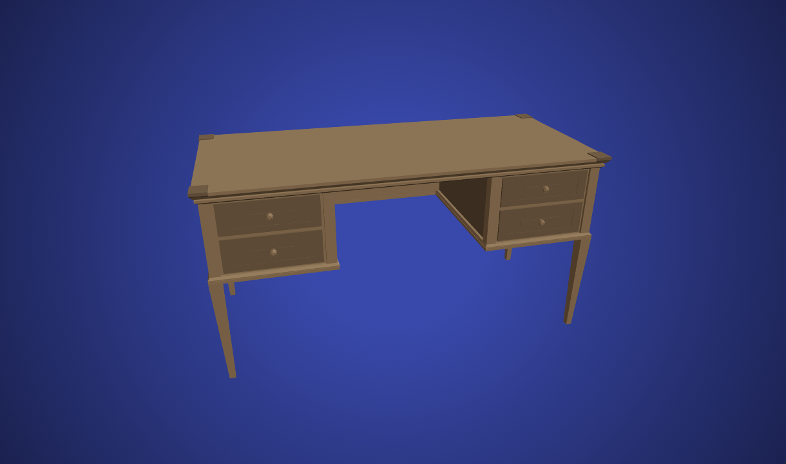

> **Runtime checkpoint — D-018, 2026-11-02:** Warm Cinematic approved; bounded robot/workshop/return delivered using this package's existing licensed sources. [Review and evidence](../../docs/ROBOT_WORKSHOP_REVIEW.md). Other worlds remain unimplemented. The planning package below is preserved historical research.

# 3D desk hub — research and selection package

**2026-11-01 · Ready for review · Research only.** The user's hub-world pivot supersedes the editorial object-card direction. No application changes, model generation, dependencies or builds are authorized by this package.

**Latest reference/setup checkpoint:** [Visual moodboard](VISUAL_REFERENCES.md) now compares the user's proposed three-game set with the hub concept: Life Is Strange warmth/storytelling, Stray atmosphere, The Room object/world entry. Actual screenshots are research-only, not production assets. The [project skill](../../../.agents/skills/portfolio-3d-hub/SKILL.md), required skill routing and actual-browser-proof rule are installed; see [setup audit](../../docs/SKILL_AUDIT.md). No hub implementation was created.

## Recommended experience

Use one desk/workbench environment, one R3F canvas and one camera controller. Four objects lead into separate mini worlds. On selection, load the destination, push the camera toward the object, briefly cover the scene change, and reveal the destination. Return restores the desk camera and the selected object's keyboard focus. Keep normal content links available throughout.

Start with **Drei CameraControls + one active world**. Evaluate **MeshPortalMaterial** later if seeing a live world inside an object is essential. Both reuse existing implementations; neither requires a new camera interpolation engine. The architecture below is a recommendation, not approved development.

| Deliverable | Read |
| --- | --- |
| Desk/room assets, scene code, interactions, cameras, portals; exact paths and rights | [Sources](SOURCES.md) |
| Robot, basketball, camera and development-object shortlist | [Object selection](OBJECTS.md) |
| Scene graph, state/return flow, routing, component boundaries and alternatives | [Architecture](ARCHITECTURE.md) |
| Four requested build phases, acceptance gates and unresolved selections | [Build plan](BUILD_PLAN.md) |
| Prior source audit and four user-priority repositories | [Existing catalog](../reusable-components/README.md) |

## Suggested reuse bundle

| Role | First inspection choice | Why / remaining issue |
| --- | --- | --- |
| Desk | H1 Quaternius desk GLB | Explicit CC0; small actual file, separate drawer nodes, no textures. Traditional wooden desk, not an industrial electronics bench |
| Room dressing | H2 Kenney Furniture Kit | CC0 modular interior pieces; archive download returned 403, so exact piece filenames remain unverified |
| Object interaction | I1 Txemalon keyboard + I2 Fiber events | Existing hover/press/emissive implementation and built-in raycasting; extract from its own canvas/site state |
| Camera | C1 Drei CameraControls / yomotsu | Existing smooth look-at, framing and transition sequencing; application still supplies object-specific camera poses |
| Mini-world switching | S1 single active scene; S2 portal optional | Keeps four destination scenes from rendering continuously; portal supports an actual visual blend when selected |
| Robot | R1 RobotExpressive | Existing licensed rig, clips and morphs; reuse prior binary/license audit |
| Basketball | B2 dLeom mesh + B1 Miles court behaviors | Finished ball appearance and separately existing shooting/scoring implementation |
| Photography | C1 Nick Ladd digital camera | Better silhouette for photography than the film or antique alternatives; CC BY 3.0 credit required |
| Software | M1 iPoly3D chip **or** I1 Txemalon keyboard | Chip stays closest to the original concept; keyboard offers existing interaction code under the newly permitted development-object alternative |

These are proposed choices. IDs H/I/C/S are local to [SOURCES.md](SOURCES.md); R/B/C/M object IDs refer to [OBJECTS.md](OBJECTS.md) and the prior catalog.

## Inspect the existing desk asset

Source: [Quaternius listing](https://poly.pizza/m/V86Go2rlnq), publisher preview `https://static.poly.pizza/91c2bf8d-0876-4801-abd3-8dd5d017ecbd.jpg`. This is an existing asset preview, not a proposed homepage render. The model's exact GLB and measured file metadata are recorded in H1.

## Evidence limits

New primary sources and exact GitHub files were read on 2026-11-01. The desk GLB was inspected in memory, not installed in the app. The official camera demo's controls loaded in Chrome, but console errors confirm WebGL context creation failed; no camera animation was observed. Kenney's ZIP returned 403. The notebook demo and portal demo were inaccessible through the web reader. Source inspection is not a working-device test.

Prior catalog visual observations remain valid only at their recorded level. No phone, tablet, GPU performance, combined hub runtime, keyboard journey or static export of a hub was tested. The existing unfinished robot prototype remains frozen and does not represent this vision.
