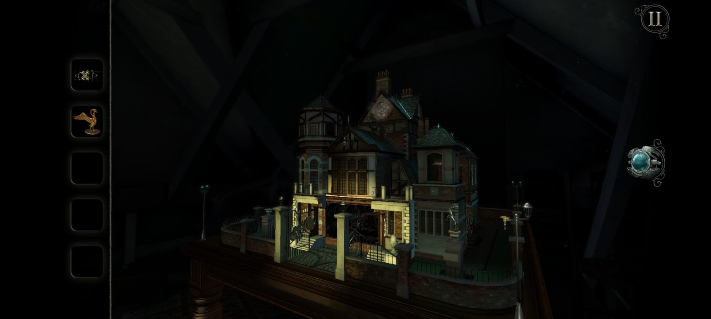
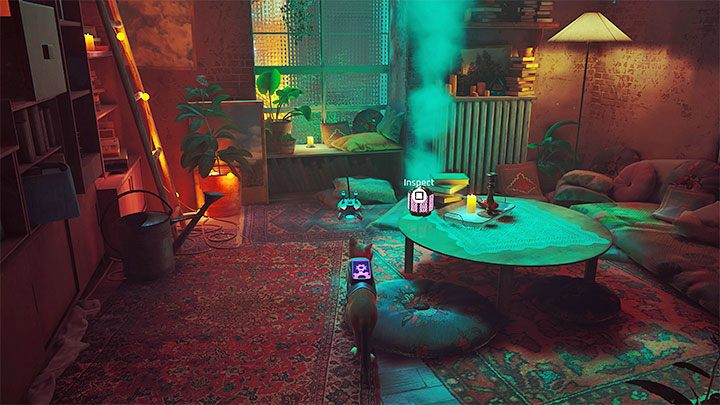
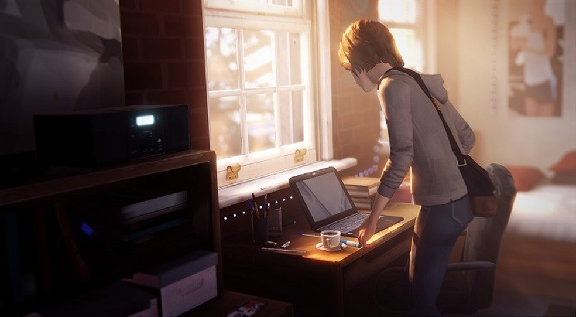
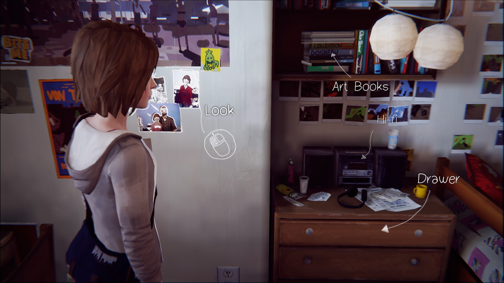
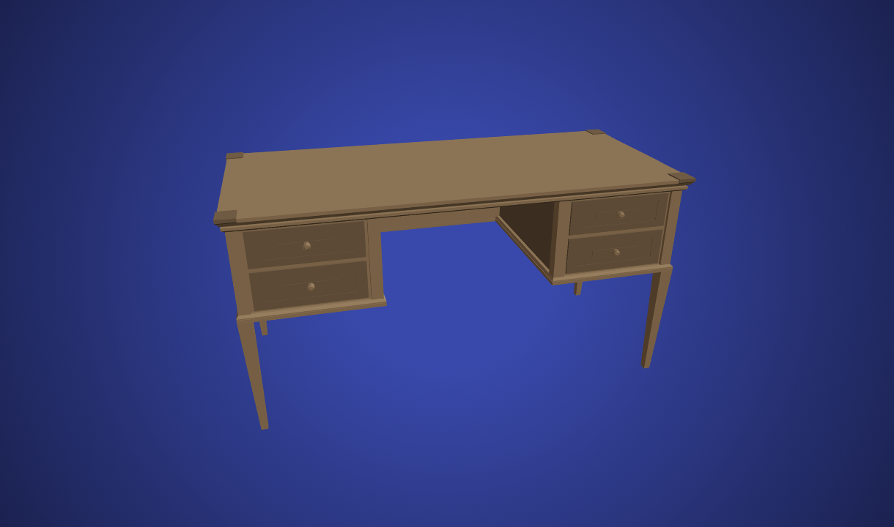

# Hub visual moodboard

**2026-11-01 · Proposed reference set supplied by the user.** These are reference choices, not claims that the user personally loves or has played these games. No hub implementation or new 3D models were created.

**Direction:** the warmth of Life Is Strange, the atmosphere of Stray and the interaction mechanics of The Room. [Open the visual board](visual-references/moodboard.html).

## The Room: Old Sins — attic dollhouse

**Borrow:** one carefully framed object as an invitation into another world; close inspection and a clear return to the larger hub. For our desk, camera approaches the selected robot/ball/camera/development object and reveals that category's world. The object must stay recognizable throughout the approach.

**Adapt:** four explicit category targets rather than hidden puzzle prerequisites. Keep entry short, cancellable and usable with keyboard/touch/reduced motion. The still establishes composition, not verified timing or animation mechanics.

[Fireproof's official game description](https://www.fireproofgames.com/games/theroomoldsins) describes the multi-room dollhouse and rooms as portals. Screenshot retrieved from [MiniReview](https://minireview.io/pt/puzzle/the-room-old-sins); copyright Fireproof Studios. Proprietary visual reference, not a reusable production asset.

## Stray — Clementine's Midtown apartment

**Borrow:** layered amber practical light and cooler environmental fill, tactile wood/fabric, plants and a lived-in focal area. Apply atmosphere around the desk while maintaining readable silhouettes and selectable objects. This is an apartment/table lighting reference, not a desk layout to duplicate.

**Adapt:** reduce dense clutter and expensive volumetrics. Try baked/low-cost lighting and material response before real-time effects. Don't use smoke, saturated color or darkness to conceal unclear interaction targets.

Room designer [Kime Honma's primary project page](https://cookime.artstation.com/projects/X1vdmw) credits room design/set dressing and lighting with Viv; raw image access returned 403. This actual gameplay screenshot comes from [Gamepressure's apartment walkthrough](https://www.gamepressure.com/stray-1/the-clementines-clue-puzzle-midtown/zb10064). Proprietary Stray imagery, BlueTwelve/Annapurna; no model/texture/audio reuse grant verified.

## Life Is Strange — Max's dorm desk

**Borrow:** warm window light, wood, a usable work surface and belongings that explain who lives here. Our robot, ball, camera and development object should read as personal possessions, rather than product cards on a platform. Surrounding props should connect to real projects/interests once the user confirms content.

**Adapt:** reserve breathing room around the four targets. Use user-cleared photos/notes and license-cleared props; don't reproduce Max's specific photographs, posters, stickers or room assets.

Desk screenshot via [TechTudo's review](https://www.techtudo.com.br/review/life-strange.ghtml). Below, the [official Feral manual](https://www.feralinteractive.com/en/manuals/lifeisstrange/latest/steam/) provides a separate dorm/dresser interaction reference, **not another desk view**. Life Is Strange copyright Square Enix, originally developed by DON'T NOD; Feral publishes the Mac/Linux version. Images are proprietary references.

## Compare the references to our current concept

| Dimension | Reference evidence | Hub concept / current gap | Future screenshot comparison |
| --- | --- | --- | --- |
| Warmth and story | Max's wood desk, window light and personal belongings | H1 desk supplies geometry only; lighting, user-specific props and composition are unimplemented | Do the objects feel owned and used? Are personal details meaningful and rights-cleared? |
| Atmosphere and depth | Clementine's warm/cool layers and tactile surroundings | Desk candidate's flat publisher backdrop supplies no room atmosphere | Does the desk remain the focal area with readable objects, foreground/background separation and restrained contrast? |
| Object-to-world entry | Dollhouse framed as the container of smaller spaces; official room-portal description | CameraControls/covered-swap proposal remains unimplemented | Can the selected object's identity and destination be understood during approach, entry and return? |
| Discoverability | Game object prompts and carefully lit focal objects | Proposed labels/highlight/DOM controls have not been rendered | Are all four targets identifiable without searching, hover or color alone? |
| Coherence | Each reference is a complete environment with consistent materials | Our source catalog contains disparate object silhouettes/materials | Do imported assets share scale, light direction and material response without flattening their character? |

**Comparison status:** concept/asset analysis only. There is no implemented hub screenshot to compare honestly yet. The old editorial robot screenshot is superseded and must not be presented as the hub. Future agents must attach actual browser screenshots beside these references and record observed differences, corrections and unresolved gaps before calling a visual milestone complete.

## Rights and evidence

These downloaded screenshots are research references only, excluded from `public/` and the production asset manifest. No proprietary game models, textures, sounds or UI were acquired. Use the [licensed-source catalog](SOURCES.md) for production candidates. Actual download URLs, source pages, rights notes, sizes and SHA256 values are retained in [provenance.json](visual-references/provenance.json). No gameplay was executed to verify the games' timing or transitions; interpretations above are visual analysis and the intended adaptation.

## Actual implementation comparison — 2026-11-02, D-018

The approved warm Cinematic room and robot workshop now exist. Compared the actual [desk](../../output/playwright/robot-journey/01-desk.png), [reaction](../../output/playwright/robot-journey/02-hover-wave.png), [approach](../../output/playwright/robot-journey/03-camera-approach.png), [workshop](../../output/playwright/robot-journey/04-workshop.png) and mobile captures against the three images above.

- **Max's desk / Life Is Strange:** retained warm wood/rug, mug, notes and personal objects. The composition is a three-quarter room view rather than the reference's intimate desk crop; placeholder notes still lack the owner's actual project stories.
- **Clementine / Stray:** preserved amber practical lighting against cool ambient fill, plants and shelf shadows. The simpler licensed meshes/materials and untextured walls have less wear/density; no volumetrics or expensive effects added to hide that gap.
- **Old Sins / The Room:** browser-tested robot approach → distinct workbench world → explicit return with restored desk pose. Covered single-world swap conveys entry; no nested visible portal, architectural depth illusion or puzzle mechanics claimed.

Adjusted existing robot orientation to make the authored Wave legible and moved its label off the face. Room geometry and all stored model bytes remain preserved. See [review/evidence/limits](../../docs/ROBOT_WORKSHOP_REVIEW.md). References remain research-only, absent from production assets.
