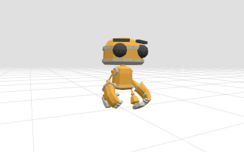
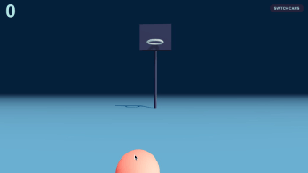
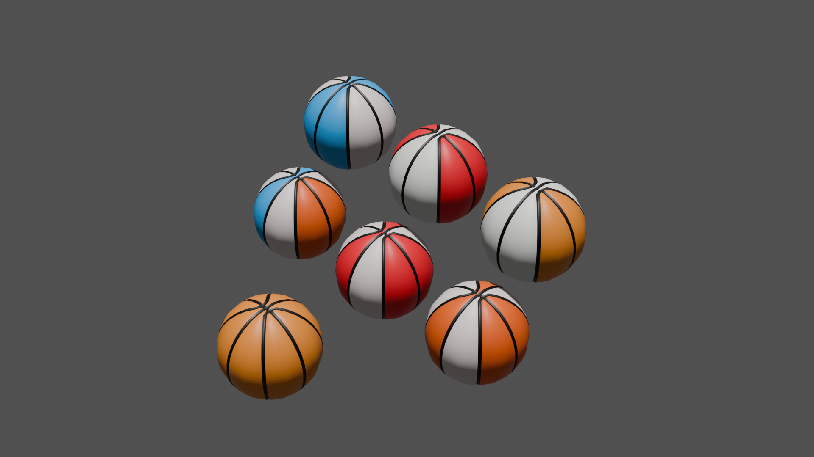
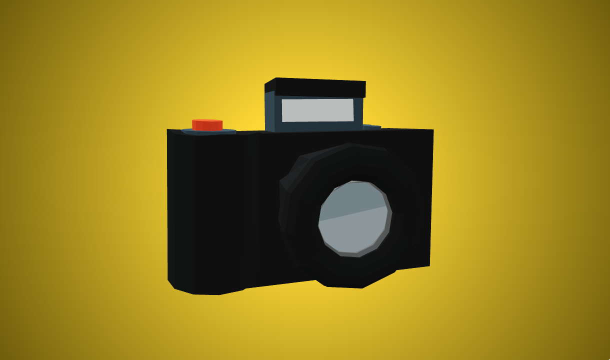
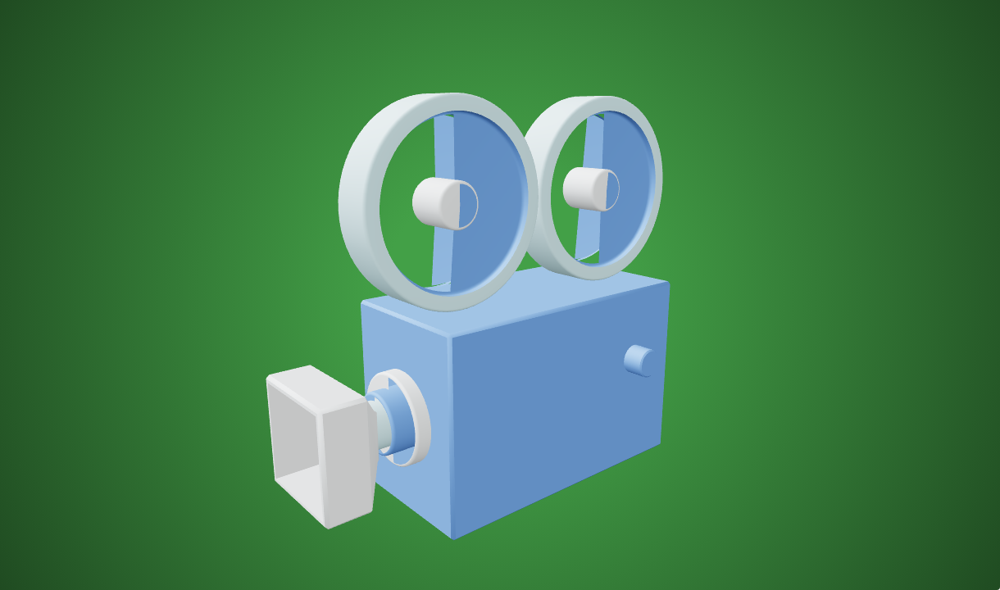
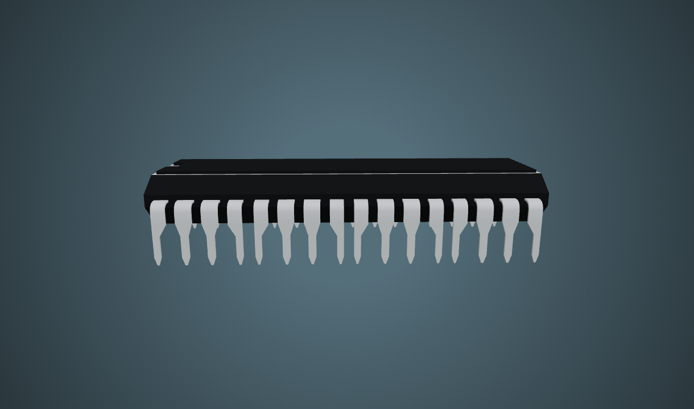

# Reusable source catalog — choose before development

> **Latest direction — 2026-11-01:** This catalog is retained source evidence. Use the [hub-world package](../hub-world/README.md) for the current desk/room experience, camera/portal systems and mini-world plan. Editorial cards are superseded. The newly allowed software-object alternative means Txemalon's keyboard can now be selected in place of a chip; it is not a second microchip model.

**Checked:** 2026-11-01. **Authority:** user's Open-Source-First correction. Application work is stopped. This catalog adds research/preview files only; it does not select, integrate, rebuild or redesign anything.

Start with the examples below, then open the object sheets for exact paths, separate licenses and modification boundaries. A public repository, HTTP 200, publisher GIF, working DOM control and successfully rendered 3D scene are different evidence levels.

## Priority repositories: what they actually provide

| Priority source | Inspect | Actual reusable material | Verification / principal issue |
| --- | --- | --- | --- |
| [Jorge-Cuevas90003.github.io](https://github.com/Jorge-Cuevas90003/Jorge-Cuevas90003.github.io) | [Live site](https://jorge-cuevas90003.github.io/), [robot details](01-robot.md#r2--jorges-chappie) | Chappie clips, section-driven robot/camera choreography, cinematic fades, detail drawer | Public tree is deployment-only, with a minified bundle; MIT code text verified, model/clip/texture rights not established. Browser capture blank here; no working 3D claim |
| [Txemalon/3d-portfolio](https://github.com/Txemalon/3d-portfolio) | [Live site](https://txemaalbero.com), [source analysis](06-priority-repositories.md#txemalon--readable-components-closest-stack-match) | Readable Next/R3F keyboard, existing hover/press/emissive reactions, section camera poses, reveal/modal components | Closest framework match; DOM/language switch observed, keyboard rendering not observed here. Fonts/audio/project media require separate rights checks |
| [react-three-basketball](https://github.com/benjaminmiles/react-three-basketball) | [Published demo](https://codesandbox.io/p/github/benjaminmiles/react-three-basketball/main), [GIF](previews/basketball-upstream.gif), [details](02-basketball.md#b1--benjamin-miles-existing-shooting-implementation) | Existing Ball/shoot/Hoop/Court physics and scoring | MIT code verified; live CodeSandbox blocked by security verification. Older React 18/Fiber 8 stack requires adaptation |
| [Three.js RobotExpressive](https://github.com/mrdoob/three.js/blob/dev/examples/webgl_animation_skinning_morph.html) | [Official demo](https://threejs.org/examples/webgl_animation_skinning_morph.html), [preview](previews/robotexpressive-upstream.jpg), [details](01-robot.md#r1--robotexpressive) | Existing GLB, authored clips, morphs, one-shot gestures and crossfade/restore implementation | MIT code and model-specific CC0 1.0 verified separately; local asset already inventoried in Phase 2. Upstream live rendering remains unverified in this browser |

## Object and transition shortlists

| Area | First inspection choice | Second candidate / alternative | Honest coverage |
| --- | --- | --- | --- |
| [Robot](01-robot.md) | R1 RobotExpressive: most reusable verified animation source | R2 Jorge Chappie: richer choreography, rights/source blockers | Two distinct robot leads; **only R1 has a verified reuse license chain**. Creator's editable RobotExpressive pack is the same character, not a second independent robot |
| [Basketball](02-basketball.md) | B1 Miles for existing interaction; B2 dLeom for finished ball appearance | B3 OpenGameArt conversion backup | Two useful sources, serving different roles; no claim of two complete drop-in games |
| [Camera](03-camera.md) | C1 Nick Ladd digital camera | C2 Kai Fan film camera; C3 Khronos AntiqueCamera | Three existing meshes; **no authored lens/shutter animation verified**. Only C3 has a verified GitHub asset path; Poly Pizza sources expose no GitHub repo |
| [Microchip](04-microchip.md) | M1 iPoly3D CC0 DIP chip | M2 KiCad QFP model, conditional format/license work | Two existing geometry sources; **zero complete animated R3F chip implementations verified**. M2 has no verified web demo/visual preview, so is a reserve, not a ready selection |
| [Transitions](05-transitions.md) | T1 Txemalon Reveal for section entries | T2 Motion AnimatePresence for mounted-content transitions; T3 Jorge cinematic system on hold | Existing implementations; none is claimed as a tested drop-in Next App Router page-transition wrapper |

## Visual inspection

These are upstream publisher previews or screenshots of existing sites, not new designs/models.

### Existing robot and basketball

### Camera and chip candidates

Full preview provenance, including the blank Jorge capture and transition before/after screenshots: [preview ledger](previews/README.md).

## Ranking method and selection boundary

Rank within the same purpose: finished mesh versus finished mesh, behavior implementation versus behavior implementation. Visual judgments use the inspected previews and are subjective, not performance scores. Missing visual evidence stays **unrated**. Functionality comes from exact source or an explicitly observed action. Licensing is a gate: unknown rights never become “low integration effort.” Effort means source adaptation complexity (small/moderate/high), not a delivery estimate or tested compatibility.

The per-object sheets identify what can be reused directly, what must change, and what remains unverified. No model or component is selected by appearing here. Source selection does not itself authorize development.

## Read next

- [Exact priority-repo analysis and compatibility](06-priority-repositories.md).
- [Exhaustive previous-source inventory](00-previous-source-inventory.md): 32 recorded GitHub repositories and 114 other URLs, including previously failed guesses. These counts describe mentions, not verified sources.
- Choose robot appearance/clip source, basketball mesh plus behavior, camera silhouette, chip package shape and transition style. Then specify which source files to adapt; do not start a new custom implementation by default.

## Current limits

Jorge's scene was blank in this browser, Txemalon's keyboard was not observed, CodeSandbox was blocked, and no phone/GPU performance test was run. No CAPTCHA/security challenge was bypassed. No repositories were installed or executed locally. Chappie GLB metadata was inspected remotely in memory, without saving/integrating it. The frozen prototype's unresolved review issues remain historical and were not fixed during this catalog task.
